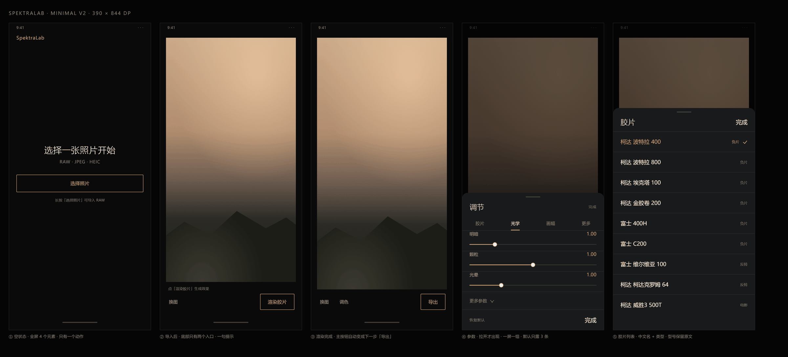

# 05 · 极简版规格（v2 · 当前基线）

> 出发点：**"太多东西让人眼花缭乱不知道怎么使用"**。
> 做法不是把颜色变淡，而是**把不用的东西从屏幕上拿掉**：一屏只留一个动作，参数拉开才出现。



① 空状态 ② 导入后 ③ 渲染完成 ④ 参数弹层 ⑤ 胶片列表（中文名）

---

## 1. 三条规则

1. **一屏一动作**：任何时刻都只有一个描边按钮，它就是"下一步"。
2. **渐进披露**：首屏只放照片 + 按钮；参数、导入方式、关于全部收进"拉开/长按"。
3. **默认值可用**：不调参数也能出片（Portra 400 + Endura + 135 是出厂配方）。

---

## 2. 元素去向表（旧界面每个东西去了哪）

| 旧界面元素 | 处理 |
|---|---|
| 词标 30–39sp 蓝色 | 缩为 13sp **accent `#D9A55B`**（与「选择照片 / 导出」按钮同色同字号），只在空状态左上角 |
| 版本号 `v1.2.6` | 删除；关于里还有 |
| 四格工作流 `01 导入 / 02 换图 / 03 渲染 / 04 导出` | **删除**，并入底部动作区 |
| 预览头 `IMAGE PREVIEW` + `(Empty / 000)` | 删除 |
| 页脚 7sp 文件名 + 状态 | 删除；只在出错时用一行 10sp 显示 |
| 面板头 `LOOK SETTINGS` + 下划线 `Reset` | 删除；`恢复默认` 放进弹层底部 |
| 四 tab（带 01/02 序号） | 移入弹层，变 4 个纯文字标签 |
| 4 条滑杆 | 移入弹层；默认只露 3 条（明暗 / 颗粒 / 光晕），眩光进「更多参数」 |
| 3 个下拉 + 片边格式 | 移入弹层的列表行（点开选值） |
| 片边 / 日期水印开关 | 移入弹层「更多」组 |
| 画幅说明 `Optical reference` | 移入「画幅」组的一行说明 |
| 参考线（GuideView） | 只保留在空状态，且 6% 白 |
| `RENDERING` 居中大字 | 删除；主按钮文案变「渲染中…」+ 照片压暗 |
| 两条 indeterminate 进度条 | 合为 1 条 1dp 线，仅渲染/导出时出现 |
| 对比手势说明 | 首次渲染后出现一次，10sp，之后不再出现 |
| 关于 / 检查更新 / GitHub 弹窗 | 保留，入口改为**长按词标** |
| Toast 错误 | 一行 10sp `danger` + 「详情」→ 弹层 |

**结果**：首屏可点元素 **18 → 2**，同屏文字节点 **40+ → 5**，字号档位 **11 → 4**，同屏色块 **6 → 1**。

---

## 3. 五屏规格

### ① 空状态（390×844）
```
┌──────────────────────────────┐
│ 9:41                    · · │ 24  系统栏
│ SpektraLab                   │ 13  accent（同主按钮），字距 .06em，左 20 / 上 32
│                              │
│                              │
│      选择一张照片开始          │ 24  Light，居中
│      RAW · JPEG · HEIC       │ 12  text.3，上 10
│  ┌────────────────────────┐  │
│  │        选择照片         │  │ 48  描边 accent，左右 20，上 28
│  └────────────────────────┘  │
│   长按「选择照片」可导入 RAW    │ 10  text.3，上 14
│                              │
└──────────────────────────────┘
```
- 可点：1（选择照片）；长按 = 导入方式弹层。
- 文字：4 块；无顶栏、无进度、无版本。

### ② 有图 · 未渲染
- 照片：左右 16、上 16、下 12，`FIT_CENTER`，黑底无边框。
- 提示行（仅此一句，10sp text.3）：「点「渲染胶片」生成效果」。
- 动作区 20 边距 / 下 14：左 `换图`（12sp text.2，44dp 命中），右主按钮 `渲染胶片`（44dp，13sp accent）。
- 可点：2。

### ③ 已渲染
- 动作区：`换图`　`调色`（两个 12sp 文本动作，间距 22）… 右侧主按钮 `导出`。
- 无提示行；失败时才出现一行 `danger`。
- 可点：3；主按钮自动变"下一步"，不需要用户判断该点哪个。

### ④ 参数弹层（从底部拉开，高度 wrap，最大 70%）
```
┌──────────────────────────────┐
│            ▁▁                │ 手柄 40×2
│ 调节                    完成  │ 头 52：20sp + 10sp
│  胶片   光学   画幅   更多     │ 标签 40，激活 2dp accent 下划线
│  明暗                    1.00 │ 滑杆 56
│  ──────●──────────────────    │
│  颗粒                    1.00 │
│  ──────────●──────────────    │
│  光晕                    1.00 │
│  ─────●───────────────────    │
│  更多参数 ⌄                   │ 48（眩光 1 项）
│ 恢复默认                  完成 │ 底 56
└──────────────────────────────┘
```
- 一次只显示一组；每组 ≤ 5 项；任何一组都不需要滚动。
- 滑杆松手才提交并重渲染（沿用现有语义）。
- 关闭 = 遮罩 / 下滑 / `完成`。

### ⑤ 值列表弹层（胶片 / 相纸 / 画幅 / 片门共用）
```
┌──────────────────────────────┐
│            ▁▁                │ 手柄 40×2
│ 胶片                    完成  │ 头 52
│ 柯达 波特拉 400     负片  ✓  │ 行 56：中文名 15sp + 类型 10sp + 勾
│ 柯达 波特拉 800      负片    │
│ 富士 维尔维亚 100    反转    │
│ 柯达 威胜3 500T      电影    │
└──────────────────────────────┘
```
- 行高 56dp，点一行即选中并关闭；选中行文字转 `accent` + 12dp 勾。
- 超过 8 行才滚动；列表从底部顶到导航栏 inset 之上。
- 中文名规则见 §6。

---

## 4. 主按钮状态机（唯一的状态提示）

```
        无照片              有照片                渲染完成
   [ 选择照片 ]  →  [ 渲染胶片 ]  →  [ 导出 ]
                        ↓ 渲染中
                   [ 渲染中… ]（禁用）
                        ↓ 失败
                   [ 重试渲染 ]
```

参数一改就自动重渲染（现有逻辑已是如此），所以**不需要"重新渲染"按钮**。

---

## 5. 文案（越短越好）

| 位置 | 文案 |
|---|---|
| 空标题 | 选择一张照片开始 |
| 格式行 | RAW · JPEG · HEIC |
| 空按钮 | 选择照片 |
| 空提示 | 长按「选择照片」可导入 RAW |
| 导入后 | 点「渲染胶片」生成效果 |
| 主按钮 | 渲染胶片 / 渲染中… / 导出 / 重试渲染 |
| 文本动作 | 换图　调色　完成　恢复默认　详情 |
| 错误行 | 渲染失败 [E-1201] + 详情 |

**导航字颜色（已定）**：`换图` `调色` 用 `text.2` `#A0A099`（次要，不抢主按钮）；弹层右上 `完成` 用 `text.1` `#EDECE8`（弹层里唯一的收尾动作）；`恢复默认` 与各类提示行用 `text.3` `#82827A`；错误行用 `danger` `#E08A76`。全部 12sp / 10sp，不做加粗。

---

## 6. 胶片 / 相纸：中文名

列表行 = **中文名**（15sp `text.1`）＋ **类型**（10sp `text.3`，右对齐）＋ 选中勾（`accent`）。
型号（400 / 100F / 500T / 推冲 +1）保留原文——翻译型号反而看不懂。

| id | 列表显示 | 类型 |
|---|---|---|
| `kodak_portra_400` | 柯达 波特拉 400 | 负片 |
| `kodak_portra_160` | 柯达 波特拉 160 | 负片 |
| `kodak_portra_800` | 柯达 波特拉 800 | 负片 |
| `kodak_portra_800_push1` | 柯达 波特拉 800 推冲 +1 | 负片 |
| `kodak_portra_800_push2` | 柯达 波特拉 800 推冲 +2 | 负片 |
| `kodak_ektar_100` | 柯达 埃克塔 100 | 负片 |
| `kodak_gold_200` | 柯达 金胶卷 200 | 负片 |
| `kodak_ultramax_400` | 柯达 至尊 400 | 负片 |
| `kodak_verita_200d` | 柯达 维利塔 200D | 负片 |
| `kodak_ektachrome_100` | 柯达 埃克塔克罗姆 100 | 反转 |
| `kodak_kodachrome_64` | 柯达 柯达克罗姆 64 | 反转 |
| `kodak_vision3_50d` | 柯达 威胜3 50D | 电影 |
| `kodak_vision3_200t` | 柯达 威胜3 200T | 电影 |
| `kodak_vision3_250d` | 柯达 威胜3 250D | 电影 |
| `kodak_vision3_500t` | 柯达 威胜3 500T | 电影 |
| `fujifilm_c200` | 富士 C200 | 负片 |
| `fujifilm_xtra_400` | 富士 X-Tra 400 | 负片 |
| `fujifilm_pro_400h` | 富士 400H | 负片 |
| `fujifilm_velvia_100` | 富士 维尔维亚 100 | 反转 |
| `fujifilm_provia_100f` | 富士 普罗维亚 100F | 反转 |
| `kodak_portra_endura` | 柯达 波特拉 恩杜拉 | 相纸 |
| `kodak_endura_premier` | 柯达 恩杜拉 顶级 | 相纸 |
| `kodak_supra_endura` | 柯达 苏普拉 恩杜拉 | 相纸 |
| `kodak_ultra_endura` | 柯达 至尊 恩杜拉 | 相纸 |
| `fujifilm_crystal_archive_typeii` | 富士 水晶影像 II 型 | 相纸 |
| `kodak_2383` | 柯达 2383 电影正片 | 拷贝片 |
| `kodak_2393` | 柯达 2393 电影正片 | 拷贝片 |
| `kodak_ektacolor_edge` | 柯达 埃克塔彩色 EDGE | 拷贝片 |

**表里没有的怎么办**：`ui/FilmNames.java` 按 `品牌_系列_型号` 推导兜底——`kodak→柯达`、`fujifilm→富士`、`ilford→依尔福`、`agfa→爱克发`、`cinestill→CineStill`…，剩下的转成「Vision3 500T」这种正常大小写。所以**任何新片基都不会退回纯英文**。
APK 里比开源引擎多带的那几个 profile（黑白片、CineStill、依尔福相纸）现在走兜底；等 Termux 侧生成 `assets/resources/stock_catalog.json`，把它们的 id 三行补进表即可。

**代码落点**：`MainActivity.readStocks()` 现在把「· 负片」直接拼进 label，要拆成两段——主名走 `FilmNames.film(id, name)`，行尾标签走 `FilmNames.typeLabel(stage, type, use)`。

---

## 7. 与 v1（常驻面板版）的差别

| | v1 面板常驻 | **v2 极简（采用）** |
|---|---|---|
| 顶栏 | 词标 20sp + 版本 | 无（词标只在空状态 13sp） |
| 面板 | 44dp 配方行，可展开到 268dp | **不常驻**，弹层拉开 |
| 状态行 | 常驻 20dp | 仅错误时一行 |
| 舞台占比 | 79% / 51% | **87% / 不变**（无面板占位） |
| 可点元素 | 3–4 | **1–3** |
| 需要学的东西 | 配方行、面板、分段、更多 | **只有一个按钮** |

v1 的四屏与样式总表保留在 `mockups/redesign.png`、`mockups/style-reference.png`，作为"面板常驻"备选方案。

---

## 8. 实施影响（比 v1 更省事）

- `MainActivity.buildUi()` 从 413 行缩到约 150 行：工作流条、面板头、页脚、状态行全部删除，四组参数改由 `ParamSheet` 构建。
- 新增 3 个类即可：`Chrome`（词标/主按钮/文本动作）、`ParamSheet`（弹层 + 4 组）、`Sheet`（列表/说明/确认）。
- `UiPicker` / `SliderRow` 仍按 `04-implementation-plan.md` 的草稿实现，只是挂到弹层里而不是常驻面板。
- 删除量 > 新增量：`setStep()`、`lightSystemBars()`（改）、`setTab()` 的 `childAt` 遍历、`selectRow()` 外壳、`toggleRow()`、`Square`、`CompareView` 里的 3 个硬编码色。

## 9. 验收

- [ ] 首屏可点 ≤ 2，文字 ≤ 5，无需滚动即可看清。
- [ ] 任何时刻只有一个描边按钮，且它就是下一步。
- [ ] 不打开弹层也能完成"选图 → 渲染 → 导出"全流程。
- [ ] 四组参数两跳内可达（拉开 + 一个标签）。
- [ ] 弹层内任一组不出现滚动条。
- [ ] 错误只占一行，点「详情」才展开全文。

---

## 10. 实现状态（2026-10-31）

| 规格项 | 代码 | 状态 |
|---|---|---|
| 一屏一动作，主按钮＝下一步 | `refreshActions()` / `onPrimary()` | ✅ 已实现 |
| 参数不常驻，点「调色」拉开 | `ParamSheet` | ✅ |
| 四组参数、一次一组、眩光收在「更多参数」 | `ParamSheet` + `SliderRow` | ✅ |
| 胶片 / 相纸中文名 + 类型标签 | `FilmNames` + `UiPicker.setItems(names, subs)` | ✅ |
| 值列表弹层（胶片/相纸/画幅/片门共用） | `Sheet.list(...)` | ✅ |
| 弹层替换 AlertDialog（导入 / 导出 / 关于 / 原生尺寸 / E-1107 / 无会话 / 渲染失败 / 导出失败 / E-1001） | `Sheet` | ✅ 9 处 |
| 错误只占一行 + 详情弹层 | `say(text, true)` + `Sheet.message` | ✅ |
| 1dp 进度线（渲染/导出共用） | `progressLine()` | ✅ |
| 暗色系统栏 / 窗口底 | `Chrome.darkSystemBars` + `themes.xml` | ✅ |
| 长按兜住 RAW / 全尺寸导出 / 关于 | `onPrimaryLong()` / 词标长按 / 弹层脚注 | ✅ |
| 首次手势提示、动画 | — | ⏳ 留给下一轮（无 JDK 无法验证动画手感） |
| 旋转 / 字体放大适配 | — | ⏳ 同上 |

> 本机没有 JDK 与 Android SDK，以上为**静态核对**结果（括号配平、符号交叉检查、悬空引用扫描全过），代码尚未编译。
